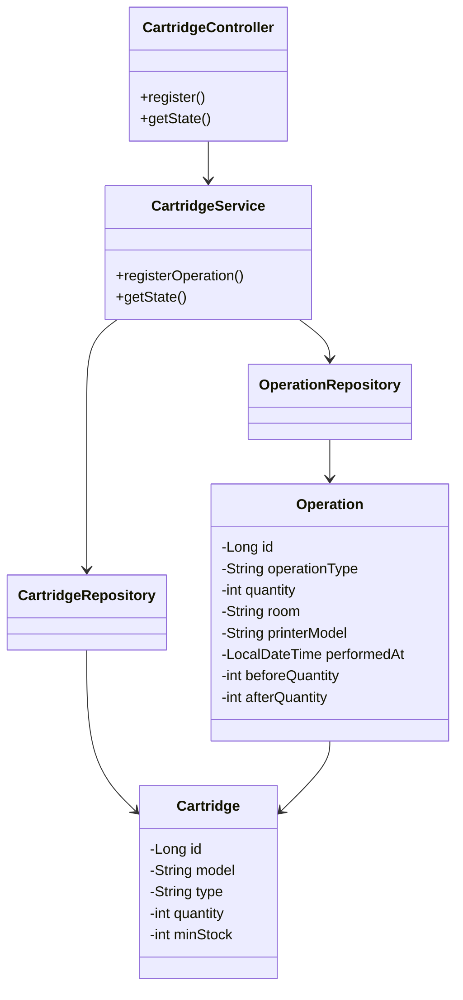
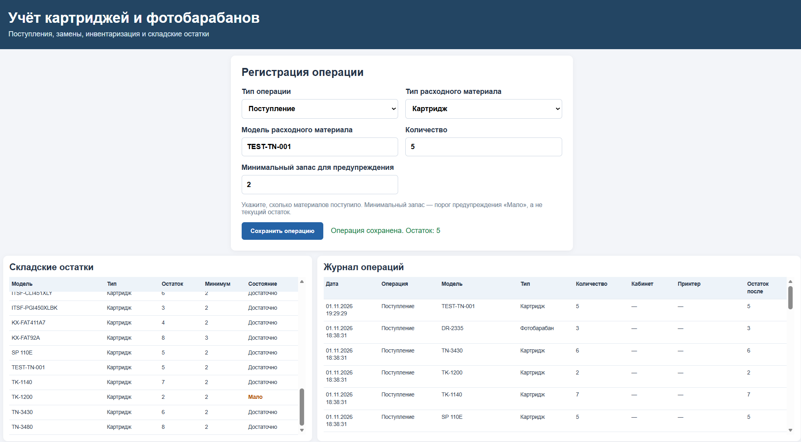
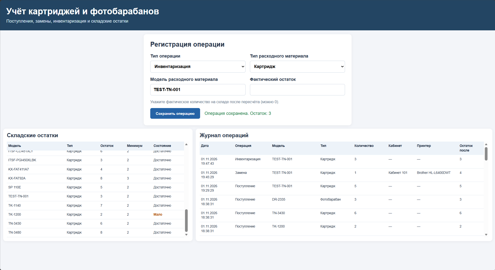
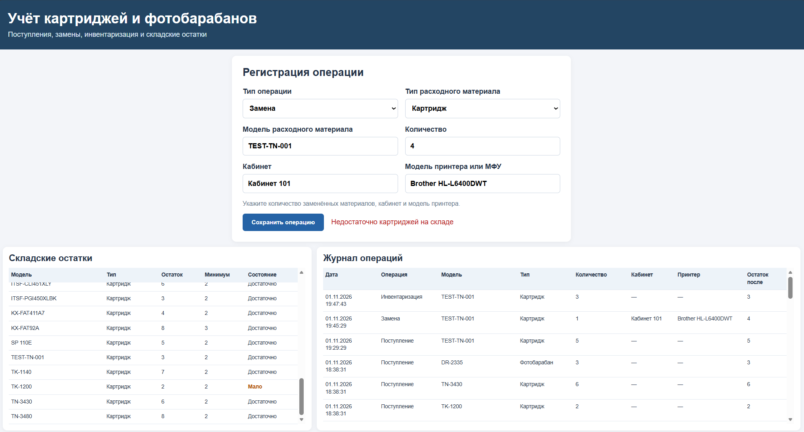
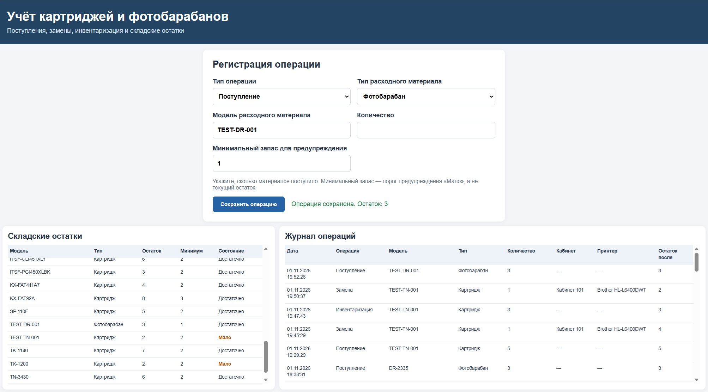

# Веб-сервис учёта картриджей и фотобарабанов

Курсовой проект по дисциплине «Разработка качественного программного обеспечения».

Приложение предназначено для технического специалиста, который ведёт складской учёт картриджей и фотобарабанов, регистрирует их поступления и замены, проводит инвентаризацию. Интерфейс работает в браузере; данные сохраняются в локальной базе H2.

## Техническое задание

**Назначение и пользователь.** Автоматизировать учёт расходных материалов печатающей техники в организации. Основной пользователь — сотрудник, отвечающий за складские остатки и замены.

**Функциональные требования:**

- регистрировать поступление картриджей и фотобарабанов, в том числе новых моделей;
- регистрировать замену с указанием кабинета и модели принтера или МФУ;
- проводить инвентаризацию с установкой фактического остатка (включая ноль);
- автоматически рассчитывать остатки и запрещать списание сверх имеющегося количества;
- предупреждать о достижении минимального запаса («Мало»);
- отображать складские остатки и журнал операций с датой, типом, количеством, кабинетом и принтером;
- предлагать ранее известные модели расходников и места замены, а также названия принтеров из справочника.

**Интерфейс.** Одна веб-страница: форма регистрации операции сверху, ниже — таблица складских остатков слева и журнал операций справа. Для смены расходного материала используются уже зарегистрированные модели. Название нового материала вводится при поступлении. Отдельный складской учёт принтеров не ведётся: одна модель картриджа может фигурировать в операциях с разными принтерами.

**Хранение.** Файловая база H2, сущности `Cartridge` (материал и его остаток) и `Operation` (история операций). Данные сохраняются между перезапусками.

**Расчётная нагрузка.** До пяти пользователей, 200 моделей расходных материалов и 100 операций в день. Это проектное предположение, а не результат нагрузочного испытания. Для увеличения нагрузки можно перейти на PostgreSQL, добавить постраничную выдачу истории и разграничение прав доступа.

**Ограничения.** Учебный локальный сервис без авторизации и внешних интеграций. Демонстрационные количества условные; названия учреждения и персональные данные сотрудников не используются. Совместимость моделей картриджей с принтерами автоматически не проверяется.

## Запуск проекта

**Требования:** JDK 17 и Windows с PowerShell. Gradle устанавливать отдельно не требуется: используется Gradle Wrapper из проекта. При первом запуске зависимости могут скачиваться из интернета.

1. Открыть корневую папку проекта `cartridge-accounting` в IntelliJ IDEA или терминале.
2. Выполнить сборку и автоматические тесты:

   ```powershell
   .\gradlew.bat clean build
   ```

3. Запустить приложение:

   ```powershell
   .\gradlew.bat bootRun
   ```

4. Открыть в браузере [http://localhost:8080](http://localhost:8080).
5. Для остановки нажать `Ctrl + C` в терминале с работающим сервером.

При первом запуске файловая база создаётся автоматически. Её рабочие файлы хранятся в папке `data/` и **не публикуются в Git**. Поэтому после клонирования репозитория склад первоначально может быть пустым.

### Демонстрационное заполнение склада

Для воспроизведения примера предусмотрен скрипт `seed-demo.ps1` в корне проекта. Он использует существующий API, добавляет демонстрационные поступления и создаёт `src/main/resources/static/printer-models.json` со списком моделей принтеров.

1. Запустить сервер командой `bootRun`, как указано выше, **не закрывая его терминал**.
2. Открыть вторую вкладку PowerShell в корне проекта и выполнить:

   ```powershell
   powershell.exe -NoProfile -ExecutionPolicy Bypass -File .\seed-demo.ps1
   ```

3. После успешной загрузки перезапустить сервер и обновить страницу браузера (`Ctrl + F5`), чтобы справочник принтеров был доступен интерфейсу.

Скрипт пропускает модели, уже имеющиеся в базе, и не перезаписывает их остатки. В исходном наборе 37 позиций расходных материалов и 48 моделей принтеров; фактическое число складских позиций зависит от уже сохранённых данных. **Все загружаемые количества являются учебными.** Если файл `printer-models.json` уже включён в копию проекта, создавать его повторно не требуется.

## HTTP API

Обмен данными выполняется в формате JSON. Реализованы **два HTTP/REST-эндпоинта**. Адреса приведены для локального сервера `http://localhost:8080`.

### `POST /api/operations` — зарегистрировать операцию

**Вход:** JSON-объект в теле запроса (`Content-Type: application/json`).

| Поле | Тип | Когда требуется и для чего |
|---|---|---|
| `cartridgeModel` | строка | Всегда: модель расходного материала (название приводится к верхнему регистру) |
| `operationType` | строка | Всегда: `RECEIPT` (поступление), `REPLACEMENT` (замена), `INVENTORY` (инвентаризация) |
| `quantity` | целое число | Всегда: при поступлении и замене больше 0; при инвентаризации от 0 |
| `type` | строка | При поступлении **новой** модели: `CARTRIDGE` (картридж) или `DRUM` (фотобарабан) |
| `minStock` | целое число | При поступлении **новой** модели: неотрицательный порог предупреждения «Мало» |
| `room` | строка | При замене: кабинет или место установки |
| `printerModel` | строка | При замене: модель принтера или МФУ |

Для уже зарегистрированной модели тип и минимальный запас берутся из базы. При поступлении количество **прибавляется** к остатку; при замене **вычитается** (без ухода в минус); при инвентаризации остаток **устанавливается** равным указанному фактическому количеству.

**Пример запроса на поступление:**

```http
POST /api/operations
Content-Type: application/json
```

```json
{
  "cartridgeModel": "DEMO-API-001",
  "operationType": "RECEIPT",
  "quantity": 3,
  "type": "CARTRIDGE",
  "minStock": 1
}
```

**Успех — HTTP 200 OK; пример ответа** при первом поступлении данной модели (значение `id` зависит от базы):

```json
{
  "id": 1,
  "model": "DEMO-API-001",
  "operationType": "RECEIPT",
  "quantity": 3,
  "balance": 3
}
```

Поля ответа: `id` — идентификатор записи операции; `model` — модель материала; `operationType` — выполненное действие; `quantity` — величина операции; `balance` — новый складской остаток.

**Ошибка проверки — HTTP 400 Bad Request.** Например, если попытаться заменить 4 картриджа при остатке 3, ответ будет таким:

```json
{
  "error": "Недостаточно картриджей на складе"
}
```

При такой ошибке остаток и журнал не изменяются.

### `GET /api/state` — получить состояние склада и журнал

**Вход:** параметров и тела запроса нет. **Успех:** HTTP 200 OK. Ответ состоит из массива `cartridges` (склад) и массива `operations` (журнал).

**Упрощённый пример ответа** после одного поступления (идентификатор и время приведены для иллюстрации):

```json
{
  "cartridges": [
    {
      "model": "DEMO-API-001",
      "type": "CARTRIDGE",
      "quantity": 3,
      "minStock": 1,
      "lowStock": false
    }
  ],
  "operations": [
    {
      "id": 1,
      "model": "DEMO-API-001",
      "type": "CARTRIDGE",
      "operationType": "RECEIPT",
      "quantity": 3,
      "room": null,
      "printerModel": null,
      "performedAt": "2026-11-01T19:30:00",
      "beforeQuantity": 0,
      "afterQuantity": 3
    }
  ]
}
```

В `cartridges`: `quantity` — текущий остаток; `minStock` — установленный минимум; `lowStock` — признак `true`, когда остаток меньше либо равен минимуму. В `operations`: `performedAt` — дата и время; `beforeQuantity` и `afterQuantity` — остатки до и после операции; `room` и `printerModel` заполняются только при замене.

В реальной базе в каждом массиве может быть много записей. Этот эндпоинт используется интерфейсом для обновления склада, журнала и подсказок расходных материалов. Список принтеров хранится отдельно в **статическом файле** `/printer-models.json`, а не в третьем REST-эндпоинте.

### Проверка HTTP API на защите

В первом терминале запустить сервер командой `.\gradlew.bat bootRun`. Затем во **второй вкладке PowerShell** выполнить:

```powershell
# GET: посмотреть несколько складских позиций
(Invoke-RestMethod http://localhost:8080/api/state).cartridges |
    Select-Object -First 3

# POST: зарегистрировать учебное поступление через API без веб-формы
$body = @{
    cartridgeModel = 'DEMO-API-001'
    operationType  = 'RECEIPT'
    quantity       = 3
    type           = 'CARTRIDGE'
    minStock       = 1
} | ConvertTo-Json
Invoke-RestMethod -Method Post -Uri http://localhost:8080/api/operations `
    -ContentType 'application/json' -Body $body
```

Ожидается объект ответа с `balance`. Затем обновить страницу браузера: новая модель появится в складе и журнале. **Повторное выполнение POST увеличит остаток ещё на 3**, поэтому для повторной демонстрации следует использовать другую уникальную модель или заранее учитывать изменение остатка.

## Архитектура

Используется многослойная архитектура: **веб-интерфейс → контроллер → сервис → репозитории → H2**.

### Диаграмма классов



### Взаимодействие компонентов

1. Пользователь заполняет форму в `index.html`; JavaScript отправляет запрос к `CartridgeController`.
2. Контроллер передаёт операцию в `CartridgeService`, где проверяются данные и пересчитывается остаток.
3. `CartridgeRepository` и `OperationRepository` обеспечивают сохранение состояния и истории в H2 через Spring Data JPA.
4. Контроллер возвращает JSON; интерфейс повторно запрашивает состояние и обновляет обе таблицы.

Используются подходы **MVC**, **Repository**, внедрение зависимостей средствами Spring и разделение ответственности между контроллером, сервисом и слоем доступа к данным.

## Технологии

| Технология | Назначение |
|---|---|
| Java 17; Spring Boot 4.0.9; Spring Web MVC | Серверная часть и REST API |
| Spring Data JPA / Hibernate; H2 | Хранение складских остатков и истории |
| HTML, CSS, JavaScript | Веб-интерфейс без дополнительных фронтенд-фреймворков |
| Gradle Wrapper | Сборка и запуск |
| JUnit 5, Mockito | Модульные тесты |
| Spring Boot Test, MockMvc | Интеграционные тесты и проверка запуска |

## Тестирование

### Автоматическое тестирование

Команда `./gradlew test` (Windows: `.\gradlew.bat test`) запускает **9 тестов**: шесть модульных, два интеграционных и один тест запуска приложения. На заключительном запуске **9 пройдены, 0 ошибок, 0 пропущенных** (100% успешности тестов — это не процент покрытия кода).

Отчёт Gradle после запуска: `build/reports/tests/test/index.html`.

Последнее измеренное в IntelliJ IDEA покрытие: **91% строк, 70% ветвей, 90% классов и 89% методов**. Эти значения относятся к отдельному измерению покрытия, а не к успешности запуска тестов.

### План и результаты системного тестирования

**Дата выполнения:** 01.11.2026. Проверка выполнена вручную через `http://localhost:8080`. Тестовые модели `TEST-TN-001` и `TEST-DR-001` должны отсутствовать в базе **до первого прохождения** сценариев. Сценарии выполняются по порядку. Для повторного прохождения следует использовать новую тестовую базу или другие уникальные имена моделей.

#### TC-01. Поступление картриджа

1. **Открыть страницу.** Ожидается: видны форма регистрации, склад и журнал.
2. **Выбрать «Поступление», «Картридж», модель `TEST-TN-001`, количество `5`, минимальный запас `2`.** Ожидается: все значения введены в соответствующие поля.
3. **Сохранить операцию.** Ожидается: модель появляется на складе с остатком `5` и состоянием «Достаточно»; журнал содержит поступление с остатком после `5`, без кабинета и принтера.

**Фактически:** поступление сохранено; остаток `5`, запись появилась. **Пройден.**



#### TC-02. Замена картриджа

1. **Выбрать «Замена», «Картридж», `TEST-TN-001`, количество `1`, `Кабинет 101`, принтер `Brother HL-L6400DWT`.** Ожидается: форма заполнена.
2. **Сохранить операцию.** Ожидается: остаток изменяется с `5` на `4`; журнал содержит замену, кабинет и модель принтера.

**Фактически:** остаток `4`; сведения о замене записаны. **Пройден.**


#### TC-03. Инвентаризация

1. **Выбрать «Инвентаризация», «Картридж», `TEST-TN-001`, фактический остаток `3`.** Ожидается: форма готова к сохранению.
2. **Сохранить операцию.** Ожидается: остаток становится равным `3`; в журнале появляется инвентаризация, кабинет и принтер не указаны.

**Фактически:** остаток `3`, операция отражена в журнале. **Пройден.**



#### TC-04. Защита от избыточного списания

1. **Выбрать «Замена», `TEST-TN-001`, количество `4`, `Кабинет 101`, принтер `Brother HL-L6400DWT`.** Ожидается: данные введены.
2. **Попытаться сохранить.** Ожидается: сообщение «Недостаточно картриджей на складе»; остаток остаётся `3`, новая запись журнала не создаётся.

**Фактически:** отображено сообщение об ошибке, остаток не изменился. **Пройден.**



#### TC-05. Предупреждение о минимальном запасе

1. **Выбрать «Замена», `TEST-TN-001`, количество `1`, `Кабинет 101`, принтер `Brother HL-L6400DWT` и сохранить.** Ожидается: операция регистрируется, остаток становится `2`.
2. **Проверить склад и журнал.** Ожидается: при минимуме `2` состояние «Мало»; в журнале замена с остатком после `2`.

**Фактически:** остаток `2`, предупреждение «Мало» отображено. **Пройден.**


#### TC-06. Учёт фотобарабана

1. **Выбрать «Поступление», «Фотобарабан», модель `TEST-DR-001`, количество `3`, минимум `1`.** Ожидается: форма заполнена.
2. **Сохранить операцию.** Ожидается: на складе создаётся фотобарабан с остатком `3` и состоянием «Достаточно».
3. **Проверить журнал.** Ожидается: запись поступления с типом «Фотобарабан», без кабинета и принтера.

**Фактически:** фотобарабан добавлен, тип и количество отображаются правильно. **Пройден.**



#### TC-07. Сохранность данных после перезапуска

1. **Остановить приложение и повторно запустить `.\gradlew.bat bootRun`.** Ожидается: сервер запускается без ошибок.
2. **Обновить страницу `http://localhost:8080`.** Ожидается: интерфейс и таблицы загружаются.
3. **Проверить модели и журнал.** Ожидается: `TEST-TN-001` — `2` шт., `TEST-DR-001` — `3` шт.; записи предыдущих операций сохранены.

**Фактически:** остатки и журнал отображены после перезапуска. **Пройден.**


**Итог системного тестирования:** 7 сценариев выполнены успешно, в том числе отклонение ошибочного списания без изменения остатка.

## Количественные результаты и личный вклад

| Показатель | Результат |
|---|---:|
| Исполнителей | 1 (индивидуальный проект) |
| Основных Java-классов | **5**: `CartridgeAccountingApplication`, `CartridgeController`, `CartridgeService`, `Cartridge`, `Operation` |
| Интерфейсов репозиториев | **2**: `CartridgeRepository`, `OperationRepository` |
| Вложенных типов `record` для передачи данных | **5**: `OperationRequest`, `OperationResponse`, `CartridgeInfo`, `OperationInfo`, `StateResponse` |
| Java-файлов приложения | **7** |
| Java-файлов с тестами | **3** |
| Строк Java в приложении | **486** |
| Строк HTML/CSS/JavaScript | **584** |
| Всего строк приложения | **1 070** |
| REST-эндпоинтов | **2** |
| Автоматических тестов | **9** |
| Системных тест-кейсов | **7** |

Подсчёт строк включает комментарии и пустые строки, но не включает Java-код тестов, файл базы данных и генерируемые файлы. `record` — отдельные типы для передачи данных, объявленные внутри классов; это не дополнительные Java-файлы.

**Объём работ и вклад участника:** проект выполнялся индивидуально, поэтому общекомандные показатели совпадают с личными. Автор сформулировал задачу и согласовал тему, определил функциональность, настроил проект, объединил компоненты сервера и веб-интерфейса, подготовил учебный склад, проверил API и работу программы, выполнил автоматическое и системное тестирование, собрал отчёт и разместил проект на GitHub. Использование ChatGPT и его вклад раскрыты в разделе ниже.

**Итог:** цель учёта поступлений, замен, инвентаризации и контроля запасов достигнута. Демонстрация и тесты подтверждают работу основных сценариев; предполагаемая нагрузка указана как расчётная и отдельно нагрузочными испытаниями не подтверждалась.

## Использование искусственного интеллекта

При работе использовалась в качестве помощи ChatGPT: для обсуждения структуры приложения и доработки Java-кода. Автор курсового проекта сформулировал прикладную задачу, согласовал тему, подбирал демонстрационные данные, запускал приложение, проверял поведение интерфейса и API, выполнял тестовые сценарии и анализировал результаты. Код и документация проверялись на работающем проекте. Отчёт отражён в README.

## Заключение

Разработан локальный веб-сервис учёта картриджей и фотобарабанов. Реализованы поступление, замена, инвентаризация, автоматический контроль остатков и журнал операций. База H2 сохраняет данные между запусками. Успешно завершены 9 автоматических и 7 системных проверок. Функциональность соответствует поставленным требованиям учебного проекта.
